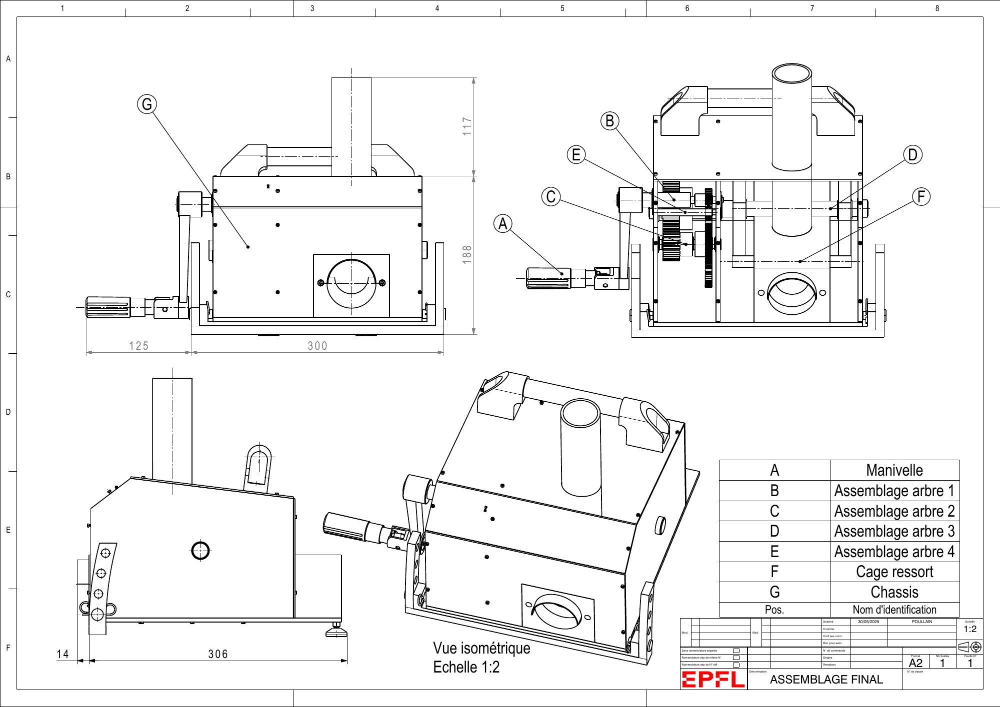

# Squash Ball Launcher — CATIA Mechanical Design

**EPFL · Mechanical Construction II · First-year Mechanical Engineering · BA2, spring 2025**

A team mechanical design project connecting analytical sizing to CATIA models, manufacturing drawings and assembly planning. We developed a manually powered squash-ball launcher with a crank-driven gear train, a compression spring and a synchronized gravity-fed ball magazine.


*Final assembly and component references, reproduced from page 26 of the team's drawing package.*

[Engineering report](docs/GM_39.pdf) · [Manufacturing and assembly drawings](docs/PDF%202D%20COMPLET.pdf) · [Project presentation](docs/Construction%20mecanique.pptx)

## Project at a glance

| Design item | Documented specification or design value |
| --- | --- |
| Power source | Manual crank; no electric motor |
| Ball magazine | Five squash balls |
| Launch-speed requirement | 80–130 km/h |
| Nominal sizing target | 90 km/h (25 m/s) |
| Nominal cadence | One ball every five seconds |
| Transmission | Two gear stages, 20:1 overall reduction |
| Spring | Selected stiffness 5,980 N/m; working compression 115 mm |
| Elevation settings | 5°, 10° and 15° |
| Reported design mass | 10.485 kg against a 15 kg limit |

These are requirements and reported design values, not independently verified measurements of a completed launcher. The documentation includes preliminary experiments on ball behaviour and feeding, alongside analytical and CAD work.

## How the mechanism works

The operator turns a crank, driving a two-stage reduction gearbox. The output rotates compression bars that move the guided launching member and load the spring. As the moving opening aligns with the magazine, one ball falls into the launch path. Release of the compression mechanism allows the spring to accelerate the ball support and propel the ball. Stops absorb the moving member's residual motion.

A pawl provides an anti-reverse function intended to limit crank kickback. The chassis supports the shafts and spring guide, while a pinned inclination mechanism sets the launch angle. The report develops the timing of the feed opening to address both missed feeds and multiple-ball release.

## Design decisions

The presentation compares wheel-based launchers, impact mechanisms and a guided spring-driven launch approach. The selected concept avoids relying on a manually maintained wheel speed and addresses the energy losses associated with striking a dissipative rubber ball.

Crank actuation was considered alongside a lever and flywheel. Spring-compression alternatives included a connecting rod, a rack, a cam and rotating compression bars. The project weighs controllability, release behaviour, mass and manufacturing complexity. The final design combines a geared crank with compression bars and a guided spring mechanism.

The design also separates several complex shapes into simpler components suitable for conventional machining, and combines custom parts with catalogue gears, bearings, keys, retaining rings and fasteners.

## Engineering analysis

The [report](docs/GM_39.pdf) connects the mechanical architecture to calculations covering:

- **Energy and actuation:** kinetic energy of the ball and moving support, spring stiffness and stroke, crank effort, torque and transmission ratio (pp. 4–7).
- **Feeding and motion:** gravity-feed timing, single-ball passage, spring return, damping, compression geometry, bar deflection and launch trajectories (pp. 7–27).
- **Efficiency:** losses in bearings, plain bearings, gears, sliding guidance and the locking mechanism (pp. 28–30).
- **Mechanical integrity:** shaft and key loading, contact pressure, plain-bearing operating conditions, rolling-bearing life, retaining rings and screws (pp. 30–42).

The initial sizing assumes a 20 N hand force at a 125 mm crank radius, giving 2.5 N·m input torque and an ideal 50 N·m after reduction. The selected spring produces approximately 688 N at 115 mm compression.

A numerical point in the original report remains relevant when interpreting the design: its stated spring parameters give approximately **39.54 J** using `E = 0.5 k x²`, whereas p. 7 reports 40.9 J. The stated kinetic-energy requirement for the ball and support is approximately 40.31 J. Consequently, the nominal 90 km/h target and energy margin require further validation, particularly when losses are included. The original submission is preserved unchanged.

## CAD, drawings and manufacturing

The 33-page [drawing package](docs/PDF%202D%20COMPLET.pdf) documents shafts, custom components, subassemblies and the final assembly. It includes dimensioned views, sections, material specifications, surface-finish requirements and assembly nomenclatures.

Manufacturing planning covers turning for rotational parts, three-axis milling for prismatic features, and drilling. The report discusses tooling, feeds, chip evacuation and cooling for the selected material families (pp. 44–49).

| Material family | Role documented in the project |
| --- | --- |
| 42CrMo4 steel | Shafts and angular supports |
| Alloy steel | Purchased transmission gears |
| Stainless steel | Compression bars and selected hardware |
| Aluminium alloy | Base and structural side plates |
| POM-H | Launching bar and selected enclosure parts |
| PE-UHMW | Guide, ball tube and ball support |
| Spring steel / music wire | Elastic elements |

The bill of materials distinguishes specified materials from approximate CATIA library equivalents. Those CAD equivalents should not be interpreted as procurement specifications.

### Fits and tolerances

The report specifies general tolerances ISO 2768-mK, with ISO 2768-fH for selected guide/container features. Its fit table addresses shaft–gear, shaft–bearing, keyway, retaining-ring and sliding interfaces. Drawing examples include shaft tolerances such as m6 and h6, keyway callouts N9, and surface roughness requirements such as Ra 1.6 or Ra 3.2.

These choices connect alignment, rotation, torque transfer and axial retention to manufacturability and assembly. The original fit table and individual drawings should be reconciled before manufacture; this portfolio is a record of the student design submission.

## Assembly and risk analysis

The report provides an illustrated assembly sequence (pp. 51–54), supported by subassembly drawings and a bill of materials (pp. 61–64). The sequence covers the spring and guide, shaft–gear assemblies, pawl, crank, chassis and inclination mechanism.

The risk analysis (pp. 43–44) considers moving parts, stored spring energy, crank return and user interaction. Proposed mitigations include protective enclosure features, an anti-reverse pawl, controlled cadence and operating instructions. The documentation also addresses inspection, maintenance and disassembly. These are design-stage measures rather than evidence of safety certification.

## Team and personal contribution

**Team:** Louis Gosset, Joseph Belamich, Guillaume Saint-Pierre and Ethan Poullain.

**My contribution — Louis Gosset:** I contributed to the mechanical concept and detailed design, CATIA 3D modelling, 2D engineering drawings, analytical calculations, material selection, risk analysis and preparation of the report in LaTeX.

We deliberately shared responsibilities across the four-person team so that each member could explore every stage of product design. These contributions describe my active involvement in shared work; they do not imply sole authorship of any subsystem or deliverable.

## Skills developed

The project provided practice in translating requirements into a mechanical architecture and carrying design decisions through to detailed documentation:

- Parametric mechanical modelling in CATIA and communicating geometry through manufacturing drawings.
- Analytical sizing of an energy-storage and transmission system, including the assumptions and limits of simplified models.
- Selecting standard components and materials around loading, friction, mass and manufacturing constraints.
- Specifying fits, tolerances and surface finishes at functional interfaces.
- Planning assembly and maintenance while considering accessibility and operator risks.
- Coordinating interfaces within a four-person team and presenting technical trade-offs in a written report and oral presentation.

## Repository contents

```text
.
├── README.md
├── assets/
│   └── final-assembly.png
├── cad/
│   ├── README.md
│   ├── manifest.csv    # File inventory and SHA-256 checksums
│   ├── native/         # 65 parts, 4 shaft products, 8 drawings and references
│   └── assembly/       # Reserved for the complete CATIA product
└── docs/
    ├── GM_39.pdf
    ├── PDF 2D COMPLET.pdf
    └── Construction mecanique.pptx
```

**Native CAD availability:** [the supplied archive](cad/README.md) contains **65 part files, four shaft subassembly products and eight native drawings**, plus reference images and a nomenclature PDF. Original names and the flat directory layout are preserved. A **complete launcher `.CATProduct` is absent** from the supplied folder; [cad/assembly/](cad/assembly/README.md) is reserved for it. Some catalogue-component references are not present as standalone files, and native assembly links have not been verified in CATIA. The final assembly remains viewable in the PDF drawing package.

The original documentation is in French; this portfolio overview is in English. PDFs can be viewed without CATIA. Native CATIA files require compatible CAD software; download the entire archive to preserve the supplied file relationships.

## Academic context and credits

Developed for **Mechanical Construction II**, taught by **Sébastien Soubielle and Bertrand Lacour**, at **EPFL**, during the second semester of first-year Mechanical Engineering in **2025**. Submitted on **1 June 2025**.

The source report also acknowledges teaching assistant Joseph Prieur and Squash Lausanne for their support and access to squash balls for preliminary experiments.

Original documents and project visuals are credited to the project team and their respective source authors. No blanket open-source licence is assigned to the supplied coursework or third-party material.
